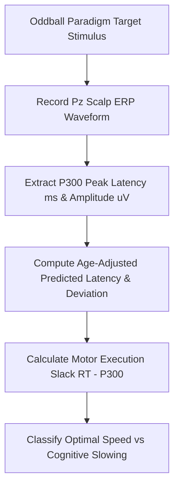

# Cognitive Event-Related Potential P300 Latency Personal Agent Skill

[](LICENSE)
[](https://www.python.org/)
[]()
[]()
[]()

Deterministic, zero-mock personal agent micro-skill for calculating Event-Related Potential P300 Peak Latency (ms), Amplitude ($\mu\text{V}$), Age-Adjusted Latency Deviation, and Motor Processing Slack using oddball paradigm electrophysiology.

## Architecture



## Quickstart

```python
from client import CognitiveP300LatencyClient

client = CognitiveP300LatencyClient()
result = client.evaluate_p300(
    p300_latency_ms=312.0,
    p300_amplitude_uv=14.5,
    patient_age_years=26,
    reaction_time_ms=370.0
)
print(result)
```

## License

Apache-2.0
